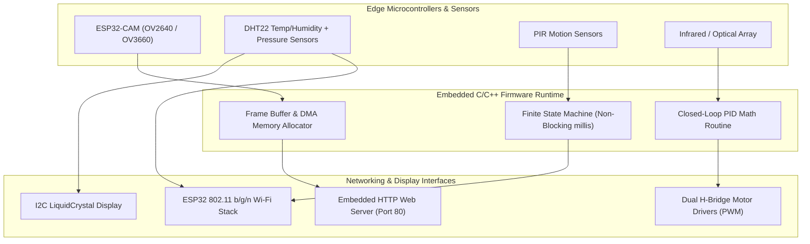

# 📡 IoT & Embedded Systems Engineering Suite

[](https://espressif.com)
[](https://arduino.cc)
[](https://isocpp.org)
[](https://en.wikipedia.org/wiki/Internet_protocol_suite)
[](https://en.wikipedia.org/wiki/Proportional%E2%80%93integral%E2%80%93derivative_controller)
[](https://opensource.org/licenses/MIT)

A unified hardware engineering and IoT monorepo containing production firmware, embedded networking implementations, sensor telemetry systems, and closed-loop robotic controllers developed across ESP32, ESP32-CAM, and Arduino microcontrollers.

---

## 📌 Problem Statement & Overview
Edge IoT devices deployed in telecom and smart-city infrastructures face severe constraints: limited SRAM, volatile Wi-Fi signal conditions, sensor drift, and thermal/power fluctuations. This repository demonstrates hardware-level diagnostics, network protocol handling, and edge computing across five dedicated modules:

1. **`esp32-video-stream-server/`**: High-throughput embedded video streaming server using OV2640/OV3660 CMOS sensors, HTTP multipart streaming, and dynamic frame-buffer memory management.
2. **`smart-sole-box-iot/`**: Award-winning healthcare sensor hardware box (Irbid Hackathon) monitoring patient pressure, temperature, and humidity via DHT sensors and microcontrollers.
3. **`autonomous-robot-pid/`**: Real-time closed-loop Proportional-Integral-Derivative (PID) controller for mobile robotics, featuring motor driver PWM tuning and optical sensor calibration.
4. **`smart-room-automation/`**: Edge home automation unit with PIR motion detection, I2C LCD diagnostic readouts, and Wi-Fi relay switches.
5. **`traffic-sign-controller/`**: High-reliability deterministic finite state machine (FSM) controlling safety signaling with strict timing guarantees.

---

## 🏗️ Architecture & Embedded Data Flow



---

## 🎯 Role-Specific Technical Evidence

### 🔧 Role 1 Fit: IT System Administrator & Cloud Infrastructure
* **Embedded Networking (TCP/IP & HTTP)**: Programmed ESP32 Wi-Fi stack configurations, DHCP/Static IP assignments, DNS discovery, and lightweight HTTP web servers serving real-time video streams and REST endpoints.
* **Hardware & Memory Diagnostics**: Debugged ESP32 PSRAM allocation and frame buffer heap limits to prevent Out-Of-Memory (OOM) resets during high-resolution JPEG captures.
* **Firmware Flashing & Toolchains**: Expert in CH340 / CP2102 USB-to-UART bridge drivers, baud rate synchronization (115200 vs 921600 bps), and Arduino CLI compilation.
* **Power & Sensor Diagnostics**: Diagnosed voltage drops, decoupling capacitor requirements, and sensor noise thresholds across multi-rail circuits.

### 🧪 Role 2 Fit: Software Quality Assurance (QA) & Testing
* **Sensor Calibration & Boundary Testing**: Created calibration routines to eliminate sensor noise, verifying sensor readings against physical calibration standards.
* **Non-Blocking Execution Verification**: Replaced naive `delay()` loops with deterministic non-blocking state timers (`millis()`) to eliminate thread starvation.
* **PID Stability Verification**: Tested robotic response under rapid trajectory changes, verifying damping ratios to prevent mechanical overshoot or oscillation.
* **Edge-Case Wi-Fi Drop Recovery**: Implemented automated Wi-Fi reconnect watchdogs to ensure autonomous recovery after router disconnects without manual device rebooting.

---

## 📁 Repository Structure

```text
├── esp32-video-stream-server/
│   ├── CameraWebServer.ino          # HTTP multipart stream server
│   ├── ESP32_Cam_ov2640.ino         # Optimized OV2640 camera driver
│   └── Esp32cam_v1.ino              # Single-frame snapshot endpoint
├── smart-sole-box-iot/
│   ├── code.ino                     # Healthcare sensor telemetry routine
│   └── 3D/                          # CAD enclosure designs & hardware schematics
├── autonomous-robot-pid/
│   ├── Robot_PID.ino                # Closed-loop PID control algorithm
│   └── Robot.ino                    # Motor driver PWM calibration
├── smart-room-automation/
│   ├── Smart_room.ino               # Multi-relay and sensor IoT firmware
│   ├── esp32_WiFi.ino               # Wi-Fi access point and client routines
│   └── LCD.Arduno.ino               # I2C diagnostic screen controller
└── traffic-sign-controller/
    └── Arduino_TrafficSign.ino      # Deterministic state-machine controller
```

---

## 🚀 Setup & Flashing Instructions

1. Install [Arduino IDE](https://www.arduino.cc/en/software) with the ESP32 board package (`https://raw.githubusercontent.com/espressif/arduino-esp32/gh-pages/package_esp32_index.json`).
2. Select target board: `AI Thinker ESP32-CAM` or `Arduino Uno`.
3. Connect device via USB-UART bridge (CP2102 or CH340).
4. Open the desired `.ino` sketch and configure Wi-Fi credentials in header variables.
5. Compile and flash firmware.
